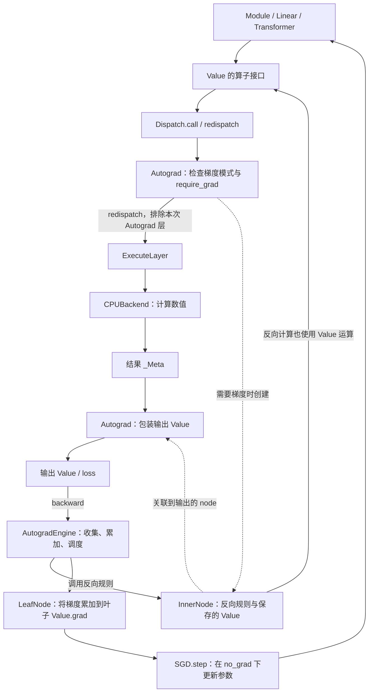
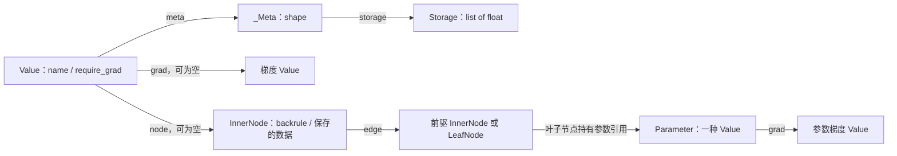
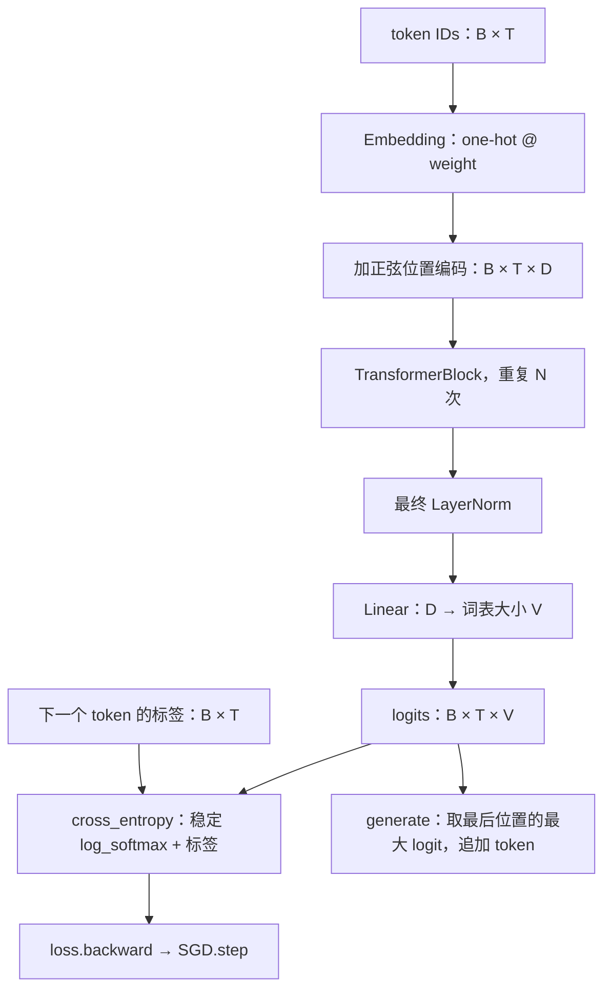
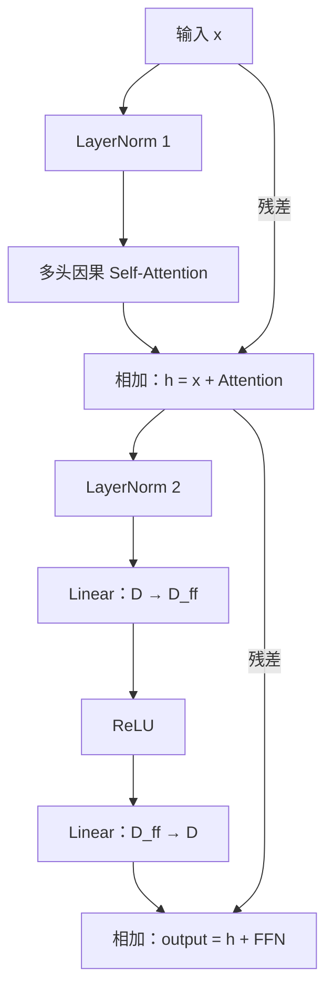
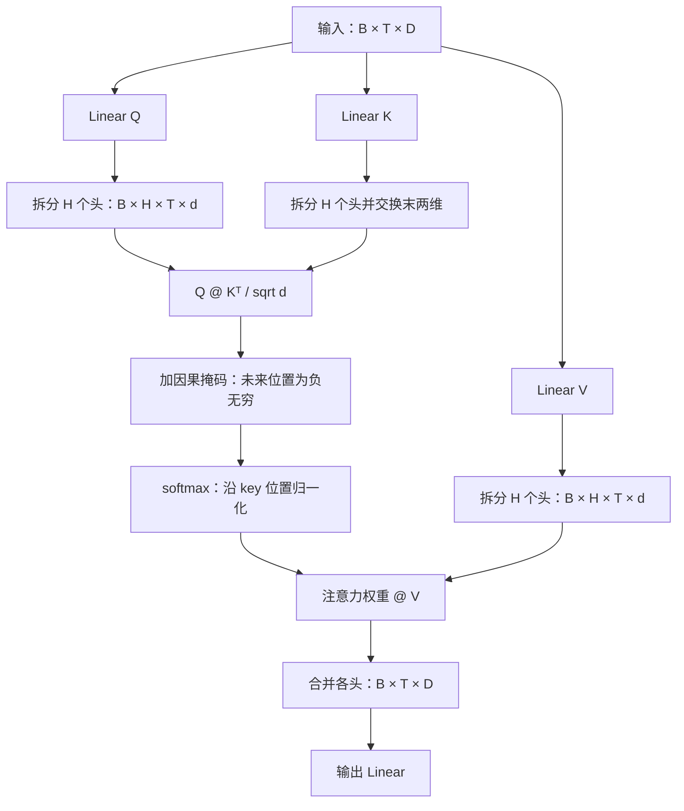

# mini-torch

用一个 Python 文件，从张量存储、算子派发和自动微分开始，逐步搭建一个能够训练的 Transformer。

核心实现位于 [`experiments/mini_torch.py`](experiments/mini_torch.py)。数值计算由 Python 列表和循环完成，核心文件只依赖 Python 标准库。项目用于理解训练框架内部的对象关系与执行过程。

## 快速运行

需要 Python 3.12 或更新版本。使用已有 Python 解释器即可运行：

```bash
python3.12 experiments/mini_torch.py --demo train --steps 80 --seed 42 --heads 2
python3.12 experiments/mini_torch.py --demo regression --steps 80 --seed 42
```

使用 uv 时，可以不安装项目的实验依赖，直接运行核心示例：

```bash
uv run --no-project --python 3.12 experiments/mini_torch.py --demo train
uv run --no-project --python 3.12 experiments/mini_torch.py --demo regression
```

如果需要 `pyproject.toml` 中的完整实验环境，可以使用 `uv sync`，再通过 `uv run python experiments/mini_torch.py` 运行。

语言模型示例学习整数 token 的循环序列 `0 → 1 → 2 → 0`。默认配置为 1 个 Transformer Block、2 个注意力头、隐藏维度 6，训练 80 步。当前默认示例的输出如下：

```text
step=000 cross_entropy=1.401482
step=079 cross_entropy=0.030312
greedy tokens: [0, 1, 2, 0, 1, 2, 0, 1, 2, 0, 1, 2]
```

## mini-torch 的架构

`Value` 是用户操作的张量对象。它把数值描述 `_Meta` 与自动微分信息组合起来；`Dispatch` 选择处理层；`Autograd` 为需要梯度的运算记录反向节点；`ExecuteLayer` 调用 CPU 数值实现。



前向时，`Autograd` 根据 `require_grad` 和当前梯度模式决定是否创建节点，再派发到 CPU 层计算。CPU 层只负责数值，最终由 `Autograd` 将结果与反向节点关联起来。

反向时，Engine 为本次任务维护临时梯度缓冲，等待节点收到所需的梯度贡献，再执行其反向规则。反向规则里的加法、乘法等仍走 `Value → Dispatch`；设置 `create_graph=True` 后，这些反向运算也可以被记录，以继续计算高阶导数。

### 数据与反向节点的关系



图中以一个有梯度的中间结果为例。需要梯度的叶子 `Value` 关联 `LeafNode`，中间结果关联 `InnerNode`；不需要梯度的结果可以没有节点。`Node` 保存反向计算规则和依赖关系，数值及最终参数梯度保存在 `Value` 中。中间节点的梯度主要由 Engine 的临时缓冲管理。

| 组件 | 职责 |
| --- | --- |
| `Storage` / `_Meta` | 保存扁平数据、形状和元素数量 |
| `Value` / `Parameter` | 提供张量操作，关联反向节点和参数梯度 |
| `Dispatch` / `OpOptions` | 整理算子参数，按优先级选择处理层 |
| `Autograd` | 检查梯度模式、创建节点、保存反向所需的信息 |
| `ExecuteLayer` / `CPUBackend` | 查找并执行数值 kernel |
| `InnerNode` / `LeafNode` | 执行反向规则，或累加叶子梯度 |
| `AutogradEngine` | 遍历反向依赖，汇总梯度并调度节点 |
| `Module` | 注册子模块与参数，递归收集参数并去重 |
| `SGD` | 清空梯度、更新参数 |

## Transformer 的架构

当前实现是用于预测下一个 token 的**因果语言模型**。它使用 Decoder 风格的自注意力，没有 Encoder 和交叉注意力。输入可以是一条 token 序列，也可以是一批等长序列。



这里 `B` 是 batch 大小，`T` 是序列长度，`D` 是隐藏维度，`V` 是词表大小。没有 batch 维时，输入为 `(T,)`，输出为 `(T,V)`。

### 一个 Transformer Block

采用 Pre-LN：先归一化，再执行 Attention 或前馈网络，最后加上残差。



### 多头因果 Self-Attention



每个头的维度 `d = D / H`。因果掩码只允许位置 `t` 关注它自己和更早的位置，训练时因此可以并行处理整条序列，同时保持下一 token 预测的因果关系。

## 使用自动微分

```python
from experiments.mini_torch import Value, _Meta

z = Value(_Meta([1, 2, 3, 4, 5, 6], (2, 3)), name="z")
loss = (z * z).sum()
loss.backward(create_graph=True)
first = z.grad
print(first.data)  # [2, 4, 6, 8, 10, 12]

z.grad = None
first.sum().backward()
print(z.grad.data)  # [2, 2, 2, 2, 2, 2]
```

`create_graph=True` 记录一阶梯度如何计算。此例再次反向得到全为 2 的结果；一般情况下，对 `first.sum()` 反向得到的是 Hessian 与全 1 向量的乘积，并不是完整 Hessian 矩阵。

训练循环仍采用熟悉的顺序：

```python
from experiments.mini_torch import TinyTransformerLM, SGD, cross_entropy

model = TinyTransformerLM(3, d_model=6, d_ff=12, num_heads=2)
optimizer = SGD(model.parameters(), lr=0.06)
tokens = [[0, 1, 2], [1, 2, 0]]
targets = [[1, 2, 0], [2, 0, 1]]

optimizer.zero_grad()
loss = cross_entropy(model(tokens), targets)
loss.backward()
optimizer.step()
```

## 当前范围

- 张量逐元素运算、数乘、批量矩阵乘法，以及显式广播、变形、转置和归约。
- `exp`、`log`、`sqrt`、`relu`、稳定 `softmax` / `log_softmax` 及相应反向规则。
- 梯度模式上下文、一阶和高阶自动微分、参数注册与 SGD。
- LayerNorm、多头因果 Attention、前馈网络、Embedding、位置编码和自回归生成。

当前执行设备固定为 CPU，`GPUBackend` 只是占位。存储采用 Python 浮点列表，没有 dtype / device 系统、共享存储视图、编译器或并行执行。Embedding 通过 one-hot 矩阵乘法实现；示例使用整数 token，没有文本 tokenizer、padding、KV cache 或模型保存接口。`retain_graph` 和计算图释放等完整生命周期管理也尚未实现。

## 文件与学习顺序

| 文件 | 内容 |
| --- | --- |
| `experiments/mini_torch.py` | 框架、模型和可运行示例的单文件实现 |
| `README.md` | 使用说明、架构图与当前范围 |
| `.python-version` | uv 使用的 Python 版本：3.12 |
| `pyproject.toml` | Python 版本要求及 PyTorch / NumPy 实验环境依赖 |
| `.gitignore` | 忽略 Python 缓存、虚拟环境和构建产物 |

建议按 `Storage / _Meta → Value → Dispatch / Autograd / CPUBackend → Node / AutogradEngine → Module / SGD → Transformer` 的顺序阅读。`test` 分支保留了逐步构建同一文件的提交记录，可以用下面的命令查看各阶段：

```bash
git log --reverse --oneline -- experiments/mini_torch.py
```

文中的 Mermaid 图可以在 GitHub README 页面直接查看。
